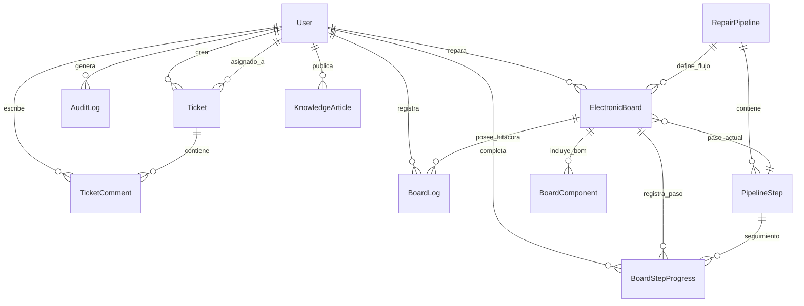

# 📊 Modelo de Datos y Esquema

Esquema relacional en PostgreSQL alojado en Supabase y gestionado mediante Prisma ORM (14 modelos, 9 enums).

---

## 📋 Entidades Principales

| Modelo | Tabla | Descripción | Relaciones Clave |
|---|---|---|---|
| **User** | `users` | Usuarios del sistema. Soporta soft delete (`deletedAt`, `isActive`). Roles: `SOLICITANTE`, `ADMIN_TI` | → Tickets, Comments, Tasks, Boards, Logs |
| **Ticket** | `tickets` | Incidencias de soporte TI. Estados: ABIERTO → EN_PROGRESO → EN_ESPERA → RESUELTO → CERRADO | → Creator, Assignee, Comments |
| **TicketComment** | `ticket_comments` | Comentarios e interacciones en tickets. Flag `isInternal` para notas técnicas privadas | → Ticket (cascade), Author |
| **Task** | `tasks` | Tareas operativas internas del área de TI. Opcionalmente vinculada a un ticket | → Creator |
| **KnowledgeArticle** | `knowledge_articles` | Artículos de la Base de Conocimiento en Markdown. `slug` único, array `tags`, contador `viewCount` | → Author |
| **AuditLog** | `audit_logs` | Registro de auditoría inmutable (append-only) para acciones críticas | → User |
| **RepairPipeline** | `repair_pipelines` | Flujo de reparación con pasos ordenados y configurables | → Steps, Boards |
| **PipelineStep** | `pipeline_steps` | Pasos individuales de un pipeline (`stepOrder`, flag `isMandatory`) | → Pipeline (cascade), BoardProgress |
| **ElectronicBoard** | `electronic_boards` | Tarjeta electrónica en taller. Código autogenerado `TRJ-YYYY-NNN` | → Pipeline, CurrentStep, Technician, Components, Logs |
| **BoardStepProgress** | `board_step_progress` | Trazabilidad del progreso de cada tarjeta por paso del pipeline | → Board (cascade), Step (cascade), CompletedBy |
| **BoardComponent** | `board_components` | Lista de materiales (BOM): componentes requeridos, en stock o instalados | → Board (cascade) |
| **BoardLog** | `board_logs` | Bitácora técnica cronológica con mediciones, alertas o notas | → Board (cascade), Author |

---

## 🧩 Diagrama Entidad-Relación (Mermaid)

---

## 🏷️ Enums del Sistema

| Enum | Valores Posibles | Propósito |
|---|---|---|
| `Role` | `SOLICITANTE`, `ADMIN_TI` | Control de acceso basado en roles (RBAC) |
| `TicketStatus` | `ABIERTO`, `EN_PROGRESO`, `EN_ESPERA`, `RESUELTO`, `CERRADO` | Ciclo de vida de tickets de soporte |
| `TicketPriority` | `BAJA`, `MEDIA`, `ALTA`, `CRITICA` | Nivel de urgencia de la incidencia |
| `TicketCategory` | `HARDWARE`, `SOFTWARE`, `RED`, `ACCESOS`, `OTRO` | Clasificación funcional del soporte |
| `BoardStatus` | `EN_COLA`, `EN_DIAGNOSTICO`, `EN_REPARACION`, `ESPERA_REPUESTOS`, `EN_PRUEBAS`, `REPARADA`, `IRREPARABLE` | Estados de la tarjeta en el taller electrónico |
| `StepStatus` | `PENDIENTE`, `EN_PROGRESO`, `COMPLETADO`, `SALTADO` | Estado individual de cada paso del pipeline |
| `ComponentStatus` | `REQUERIDO`, `EN_STOCK`, `SOLICITADO`, `INSTALADO` | Estado de adquisición y montaje en la BOM |
| `BoardLogType` | `NOTA_TECNICA`, `MEDICION`, `CAMBIO_ESTADO`, `ALERTA` | Tipo de evento en la bitácora técnica |
| `AuditAction` | `CREATE`, `UPDATE`, `DELETE`, `STATUS_CHANGE`, `LOGIN`, `LOGIN_FAILED` | Tipo de acción en el registro de auditoría |
| `AuditEntity` | `TICKET`, `TASK`, `KB_ARTICLE`, `USER`, `ELECTRONIC_BOARD`, `PIPELINE` | Entidad afectada en auditoría |

---

## ⚙️ Configuración de Conexión en `prisma/schema.prisma`

Para mitigar límites de conexiones en entornos serverless de Vercel y Supabase:
- **`DATABASE_URL`**: Conexión al pooler (puerto `6543`) con parámetro `?pgbouncer=true`.
- **`DIRECT_URL`**: Conexión directa a PostgreSQL (puerto `5432`) requerida por Prisma para migraciones (`db push`) y preparación de esquemas.

---

*Ver más:* [[00-INDEX|Índice General]] · [[01-arquitectura|Arquitectura]] · [[05-modulos-sistema|Módulos del Sistema]]
